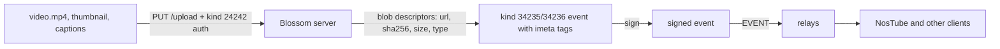

# Nostr and Blossom Basics

Background for agents new to Nostr and Blossom. Read this before the other references if terms like relay, event, `npub`, `imeta` or blob descriptor are unfamiliar.

## Nostr in One Page

Nostr is a protocol of signed JSON messages ("events") passed through simple servers ("relays"). There are no accounts on servers: an identity is a key pair.

- **Keys**: a secp256k1 key pair (Schnorr signatures, BIP-340). The public key (`pubkey`, 64 hex chars) is the identity; the secret key signs. Never print, log or commit a secret key.
- **Encodings (NIP-19)**: human-facing bech32 forms. `npub…` public key, `nsec…` secret key, `note…`/`nevent…` an event, `naddr…` an addressable event (kind + pubkey + `d` tag + relay hints). `ncryptsec…` is a password-encrypted secret key (NIP-49). Events and relays always use hex internally.
- **Event (NIP-01)**: `{id, pubkey, created_at, kind, tags, content, sig}`. `id` is the SHA-256 of the canonical serialization `[0, pubkey, created_at, kind, tags, content]`; `sig` signs the id. Change any field and you must re-sign.
- **Kinds**: the integer `kind` says what an event is. Ranges matter:
  - regular (e.g. `1` text note, `21` video): every event is kept
  - replaceable `10000–19999` (and `0`, `3`): relays keep only the newest per pubkey + kind
  - addressable `30000–39999` (e.g. `34235` video): relays keep only the newest per pubkey + kind + `d` tag. Republishing with the same `d` tag and a newer `created_at` replaces the event; this is how videos are edited.
  - ephemeral `20000–29999` (e.g. `24242` Blossom auth): not stored
- **Tags**: arrays of strings; the first element is the tag name. Single-letter tags (`d`, `e`, `p`, `a`, `t`, `r`, …) are indexed by relays and can be filtered with `#x` filters.
- **Relays**: WebSocket servers. Client messages: `["EVENT", <event>]` to publish, `["REQ", <sub-id>, <filter>…]` to query, `["CLOSE", <sub-id>]`. Relay answers: `["OK", <id>, true|false, "<reason>"]`, `["EVENT", <sub-id>, <event>]`, `["EOSE", <sub-id>]`. A relay may refuse writes (allow lists, payment, NIP-42 `AUTH`); always check the `OK` message.
- **Where to publish (NIP-65)**: a user's kind `10002` event lists their read/write relays. Publish to the write relays plus the relay of the target site/instance.
- **Signing in apps**: browser extensions expose `window.nostr` (NIP-07); remote signers ("bunkers") sign over Nostr (NIP-46). Servers may hold a managed key and sign on behalf of an authenticated admin (see NosTube below).

## Blossom in One Page

Blossom stores files ("blobs") on plain HTTP servers, addressed by the SHA-256 of their bytes. Nostr keys authorize uploads; the same blob can live on many servers under the same hash.

- **Retrieve**: `GET /<sha256>[.ext]`, check with `HEAD /<sha256>` (BUD-01). Any server holding the blob serves identical bytes, so a client can swap servers by hash.
- **Upload**: `PUT /upload` with the raw bytes (BUD-02). The answer is a **blob descriptor**: `{url, sha256, size, type, uploaded}`. Always verify that `sha256` matches your own hash.
- **Pre-check**: `HEAD /upload` with `X-SHA-256`, `X-Content-Length`, `X-Content-Type` tells whether the upload would be accepted (BUD-06).
- **Mirror**: `PUT /mirror` with `{"url": "<blob url elsewhere>"}` copies a blob server-to-server (BUD-04).
- **Authorization (BUD-11)**: a signed kind `24242` event, base64url-encoded in `Authorization: Nostr <token>`. It needs a human-readable `content`, `["t", "upload"|"get"|"delete"|"list"|"media"]`, `["expiration", "<unix>"]`, and for uploads `["x", "<sha256>"]`. Optional `["server", "<domain>"]` scopes it to one server. `created_at` must be in the past.
- **User server list (BUD-03)**: kind `10063` with `["server", "<url>"]` tags lists the user's Blossom servers, in preference order.
- **Errors**: servers put the refusal reason in the `X-Reason` response header.

Chunked `PATCH /upload` (with `Upload-Offset`/`Upload-Length`) is not part of the official BUDs: NosTube code calls it "BUD-10" after an earlier draft, but the current BUD-10 is the `blossom:` URI schema. Only some servers support PATCH; use plain `PUT /upload` unless `OPTIONS /upload` advertises it.

## How a Video Post Fits Together

- The relay and Blossom server accept writes only from allowed pubkeys (`allowed_writers` in the server config; the studio adds the managed key and the creators).

## NosTube Server Instances

A self-hosted NosTube server (`apps/server` in this repo) is relay + Blossom server + admin studio on one origin:

- Relay: `wss://<host>`; Blossom: `https://<host>/upload`, blobs at `https://<host>/<sha256>.<ext>`.
- `GET https://<host>/api/config` shows the public config (`creators`, relays). `/.well-known/nostr.json?name=_` names the managed key's pubkey.
- Writes are limited to allowed pubkeys (the instance's creators).
- The **managed key** never leaves the server. An admin session (cookie `admin_session`, from logging in to `/studio/`) can ask the server to sign: `POST /api/admin/signer/sign` with `Content-Type: application/json` and an unsigned `{kind, created_at, tags, content}` body answers the signed event. Use it for both the kind `24242` upload auth and the video event. Get the cookie value from the user via a file or environment variable, never through chat; it is valid for 7 days.
- Event builders shared with the studio: `packages/core/src/blossom-auth.ts` (`buildUploadAuth`, `blossomAuthorization`) and `packages/core/src/video-publish.ts` (`buildVideoEvent`).

## Specs

Nostr NIPs (https://github.com/nostr-protocol/nips, one file per NIP, e.g. `71.md`; rendered at https://nips.nostr.com):

| NIP | Topic |
|---|---|
| [01](https://github.com/nostr-protocol/nips/blob/master/01.md) | Events, signatures, kinds, relay messages, filters |
| [05](https://github.com/nostr-protocol/nips/blob/master/05.md) | `name@domain` identifiers via `/.well-known/nostr.json` |
| [07](https://github.com/nostr-protocol/nips/blob/master/07.md) | Browser signer `window.nostr` |
| [19](https://github.com/nostr-protocol/nips/blob/master/19.md) | bech32 encodings: npub, nsec, nevent, naddr |
| [32](https://github.com/nostr-protocol/nips/blob/master/32.md) | Labels: `L`/`l` tags (language) |
| [36](https://github.com/nostr-protocol/nips/blob/master/36.md) | `content-warning` |
| [40](https://github.com/nostr-protocol/nips/blob/master/40.md) | `expiration` tag |
| [42](https://github.com/nostr-protocol/nips/blob/master/42.md) | Relay authentication (`AUTH`) |
| [46](https://github.com/nostr-protocol/nips/blob/master/46.md) | Remote signing (bunker) |
| [49](https://github.com/nostr-protocol/nips/blob/master/49.md) | Password-encrypted secret key (`ncryptsec`) |
| [65](https://github.com/nostr-protocol/nips/blob/master/65.md) | Relay list, kind `10002` |
| [71](https://github.com/nostr-protocol/nips/blob/master/71.md) | Video events: kinds `21`/`22`, addressable `34235`/`34236` |
| [89](https://github.com/nostr-protocol/nips/blob/master/89.md) | `client` tag |
| [92](https://github.com/nostr-protocol/nips/blob/master/92.md) | `imeta` media attachments |
| [94](https://github.com/nostr-protocol/nips/blob/master/94.md) | File metadata, kind `1063` |
| [98](https://github.com/nostr-protocol/nips/blob/master/98.md) | HTTP auth, kind `27235` |

Blossom BUDs (https://github.com/hzrd149/blossom/tree/master/buds): [01](https://github.com/hzrd149/blossom/blob/master/buds/01.md) retrieval, [02](https://github.com/hzrd149/blossom/blob/master/buds/02.md) upload, [03](https://github.com/hzrd149/blossom/blob/master/buds/03.md) server list `10063`, [04](https://github.com/hzrd149/blossom/blob/master/buds/04.md) mirror, [05](https://github.com/hzrd149/blossom/blob/master/buds/05.md) media optimization, [06](https://github.com/hzrd149/blossom/blob/master/buds/06.md) upload pre-check, [08](https://github.com/hzrd149/blossom/blob/master/buds/08.md) NIP-94 tags in descriptors, [11](https://github.com/hzrd149/blossom/blob/master/buds/11.md) authorization, [12](https://github.com/hzrd149/blossom/blob/master/buds/12.md) list/delete.

In this environment the `nostr` MCP tools (`read_nip`, `read_kind`, `read_tag`) return NIP text offline; `nak nip <number>` does the same.

## Tools

- **nak** (https://github.com/fiatjaf/nak), the Nostr CLI:
  - `nak key generate`, `nak key public <hex-sec>`: key pairs
  - `nak encode naddr -k 34235 -p <pubkey> -d <d-tag> -r <relay>`, `nak decode <nip19>`
  - `nak event --sec <key> <relay…> < event.json`: signs a partial event from stdin (exact tags kept) and publishes it; an already signed event on stdin is published unchanged
  - `nak req -k 34235 -a <pubkey> -t d=<d-tag> <relay>`: query; `nak fetch <naddr>` follows relay hints
  - `nak blossom upload|check|mirror|list --server <host>`: Blossom operations
  - `nak kind <n>`, `nak nip <n>`: offline docs
- **ffmpeg / ffprobe**: inspect, transcode, extract thumbnails (see [Transcode and Upload](transcode-upload.md)).
- **yt-dlp**: download videos plus metadata, thumbnails and subtitles from external platforms (X, YouTube, …) for import; keep the source URL for `r`/`origin` tags.
- **Libraries**: `nostr-tools` (event types, signing, NIP-19), `applesauce-*` (NosTube's event store, relay pool, signers; docs https://hzrd149.github.io/applesauce/), `blossom-client-sdk` (Blossom auth and uploads).
