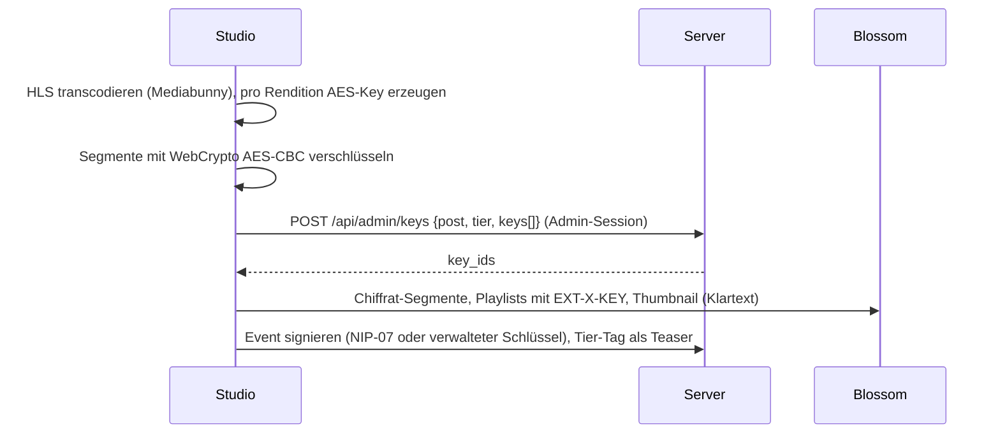
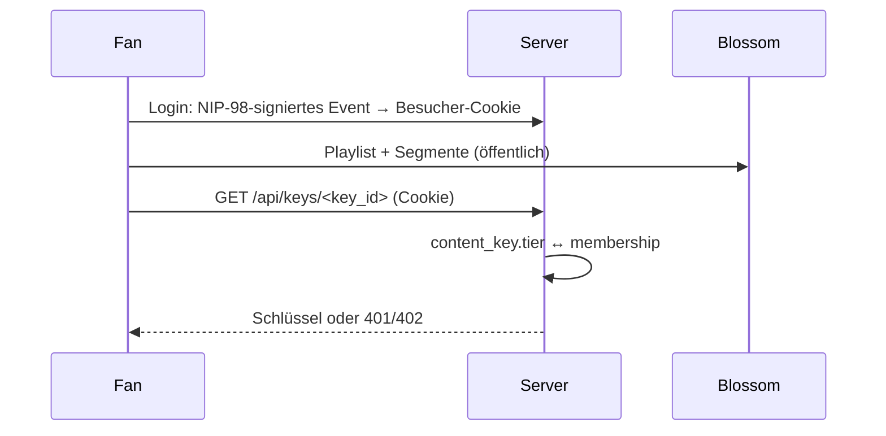

# Nostube Server: Mitgliedschaften (Patreon-Modell)

Stand: 13. Oktober 2026. Entwurf zur Review, keine Umsetzungsfreigabe. Ergebnis eines Konzeptgesprächs; Aussagen über den bestehenden Code sind mit Datei belegt, ungeprüfte Annahmen sind als **[Annahme]** markiert.

## 1. Ziel

Ein Creator betreibt seine Instanz nicht nur als Videohomepage, sondern als Mitgliederseite:

- Er veröffentlicht Videos **und** andere Beiträge (Notizen, Bilder, Artikel) in einem Feed.
- Er definiert **Tiers** (Stufen mit Preis und Rang).
- Beiträge sind öffentlich oder einem Tier zugeordnet; nur Mitglieder dieses Tiers (oder eines höheren) können sie ansehen.
- Mitgliedschaften entstehen durch Zahlung oder durch den Admin.

**Nicht-Ziele:** DRM, Schutz gegen Abfilmen oder gegen einen zahlenden Fan, der Inhalte aktiv weitergibt. Patreon verhindert das auch nicht. Ziel ist, dass ein Leak **aktiv** und **nicht mehr authentisch** ist (siehe 4).

## 2. Begriffe

Ergänzungen für `apps/server/CONTEXT.md`, sobald entschieden:

**Tier** (Stufe): Vom Admin definierte Mitgliedsstufe mit Id, Name, Rang und Preis. Ein höherer Rang schließt die niedrigeren ein.

**Mitgliedschaft** (Membership): Recht eines Unterstützers auf ein Tier bis zu einem Zeitpunkt, mit Herkunft (Admin, Zap, NWC, …).

**Unterstützer** (Supporter): Besucher mit mindestens einer gültigen Mitgliedschaft. _Avoid_: Abonnent, Follower, Member.

**Gesperrter Beitrag**: Beitrag, dessen Inhalt verschlüsselt ist und dessen Schlüssel nur ab einem Tier ausgegeben wird. Titel, Thumbnail und Tier sind öffentlich (Teaser).

**Beitragsschlüssel** (Content key): Symmetrischer Schlüssel, mit dem ein gesperrter Beitrag (bzw. eine Rendition davon) verschlüsselt ist. Liegt nur auf der Instanz.

**Besucher-Session**: Signiertes Cookie, das einem Browser einen Nostr-Pubkey zuordnet, ausgestellt nach einem Login mit dem Besucherschlüssel.

**Dienstidentität** (Service identity, optional, siehe 9): Ein von der Instanz gehaltener Schlüssel, der automatisierte Nachrichten und Zahlungsbelege signiert. Entspricht dem „payment verifier“ aus NIP-88 (PR #866, siehe 15). Ausdrücklich **keine** Creator-Identität. _Avoid_: Bot-Creator, Server-Creator.

## 3. Ausgangslage im Code

| Thema | Heute | Beleg |
|---|---|---|
| Relay-Lesen | Jeder bekommt jedes Event, kein NIP-42 | `src/relay.rs:358` (`Req` → `query`) |
| Relay-Schreiben | Zugelassene Schreiber plus Besucherinteraktionen | ADR 0006, ADR 0011 |
| Blossom | almond als Bibliothek; `GET` öffentlich, Auth nur beim Upload | `src/main.rs:292`, `:460` |
| Vorschaltung | Jede Blossom-Anfrage läuft durch `dispatch`, bevor almond sie sieht | `src/main.rs:460-494` |
| Inhaltsbezug | `media_ref (event_hash, hash)` mit Index auf `hash`; `blob_owner (hash, author)` | `src/relay.rs:118-123`, `src/outbox.rs:46` |
| Sessions | Zustandsloses HMAC-Cookie für den Admin | `src/admin.rs:200-210` |
| Vorabsignierte Events | Geplante Veröffentlichung speichert fertig signierte Events | `src/schedule.rs:1-10` |
| Mirror | Outbox spiegelt alle Events und Blobs der Schreiber; Blob-Mirror braucht den verwalteten Schlüssel | ADR 0009 |
| Hash-Fallback | Der Player probiert **jeden** konfigurierten Blossom-Server mit dem Hash | `packages/core/src/media-url-generator.ts:261` |
| SEO | Titel, Beschreibung, Thumbnail im serverseitigen HTML, `feed.xml`, `atom.xml`, `sitemap.xml` | `src/seo.rs`, `src/main.rs:505-520` |
| Homepage | Zeigt nur Videos der angezeigten Creator | `CONTEXT.md` |

Fazit: Die Instanz ist an jeder Stelle bewusst öffentlich lesbar. Die Datenbasis (`relay.sqlite`) und der Ort für eine Zugriffsprüfung (`dispatch`) existieren aber schon.

## 4. Bedrohungsmodell

| Angriff | Klartext-Gating | Verschlüsselung |
|---|---|---|
| Nicht-Mitglied ruft Blob direkt ab | verhindert (401) | Blob ist Chiffrat, wertlos |
| Mitglied lädt Blob herunter und lädt ihn auf einen fremden Blossom-Server | **gleicher Hash**; jeder Nostube-Player findet die Kopie über das öffentliche Event automatisch (`media-url-generator.ts:261`) | Kopie ist Chiffrat, wertlos |
| Mitglied postet das vom Creator signierte Event auf fremde Relays | Event + gespiegelter Blob = **authentische** Kopie des Originals | Event verweist auf Chiffrat, wertlos ohne Schlüssel |
| Mitglied gibt den Schlüssel (16 Byte) weiter | – | **offen**: Schlüssel + öffentliches Event öffnen den Beitrag für alle |
| Mitglied entschlüsselt und lädt Klartext neu hoch | – | offen, aber neuer Hash, neuer Autor, nicht mit dem Original verknüpft |
| Abfilmen, Bildschirmaufnahme | offen | offen (nur Wasserzeichen pro Fan würde helfen, siehe 12) |
| Datenbank- oder Host-Kompromittierung | – | alle Beitragsschlüssel offen (siehe 12) |

Entscheidend: Bei Nostr ist ein signiertes Event portabel, und Blossom adressiert nach Inhalt. Alles, was als Klartext in einem signierten Event oder unter einem öffentlichen Hash steht, lässt sich als Original weiterverbreiten. Verschlüsselung verschiebt die Schwachstelle vom Blob auf den Schlüssel; ein Leak wird dadurch eine bewusste Handlung und verliert die Echtheit.

## 5. Architekturentscheidung: Verschlüsseln statt Zugriff sperren

Erwogene Varianten:

| Variante | Prinzip | Bewertung |
|---|---|---|
| A: Blob-Gating | Event öffentlich, Blossom liefert Blobs nur an Mitglieder | Hash-Leak (4); Prüfung bei **jedem** Range-Request und HLS-Segment; `<video src>` kann keinen `Authorization`-Header senden, also nur mit Cookie auf demselben Origin |
| B: Event-Gating | Relay mit NIP-42, `REQ` nach Tier gefiltert | Für Nicht-Mitglieder unsichtbar statt „gesperrt“; Outbox darf nichts spiegeln; signiertes Event bleibt portabel |
| **C: Verschlüsselung** | Event und Blobs öffentlich, Inhalt verschlüsselt, nur der Schlüssel-Endpunkt prüft die Mitgliedschaft | **Gewählt.** Blossom und Relay bleiben unverändert; eine Prüfung pro Beitrag statt pro Segment; Mirror von Chiffrat erlaubt |

Folgen von C:

- Blossom bekommt **kein** Gating und muss nichts über Nutzer oder Inhalte wissen.
- Das Relay bekommt **kein** NIP-42 (außer es werden später unsichtbare Beiträge gewünscht).
- Die Outbox darf gesperrte Beiträge spiegeln; Schlüssel verlassen die Instanz nie.
- SEO, Embed und oEmbed sehen nur den Teaser, weil nur der öffentlich ist.

## 6. Datenmodell

Alles in `relay.sqlite`, damit Schlüssel und Events gemeinsam gesichert werden und Schreibvorgänge transaktional bleiben (gleiche Begründung wie ADR 0009).

```sql
CREATE TABLE content_key (
  key_id TEXT PRIMARY KEY,        -- zufällig; steht im Inhalt: /api/keys/<key_id>
  post   TEXT NOT NULL,           -- Beitrag (Koordinate kind:pubkey:d oder Event-Id), für Tierwechsel aller Renditions
  key    BLOB NOT NULL,           -- 16 Byte (HLS AES-128) bzw. 32 Byte (AES-GCM für Text)
  tier   TEXT NOT NULL,           -- Tier-Id aus der Config oder 'public'
  created_at INTEGER NOT NULL
);
CREATE INDEX content_key_post ON content_key(post);

CREATE TABLE membership (
  pubkey      TEXT NOT NULL,      -- Unterstützer (hex)
  tier        TEXT NOT NULL,
  valid_until INTEGER NOT NULL,
  source      TEXT NOT NULL,      -- 'admin' | 'zap:<receipt-id>' | 'nwc:<payment-hash>' | …
  PRIMARY KEY (pubkey, tier)
);
```

Ohne eigene Tabelle:

- **Tiers** stehen in `config.toml` (`[[tiers]] id, name, rank, price`); Name, Rang und Preis zusätzlich in der public config für die Anzeige. Es sind wenige, der Admin pflegt sie, sie ändern sich selten.
- **Besucher-Session**: wie `sign_session` in `admin.rs`, aber mit Pubkey im MAC: `cookie = <pubkey>.<expires>.<HMAC(pubkey|expires)>`. Eigener Cookie-Name, getrennt vom Admin-Cookie. Kein Session-Store.
- **Beitrag → Schlüssel**: steht im Inhalt selbst (`#EXT-X-KEY:URI=…/api/keys/<key_id>` in der Playlist, Tag `["key", "<key_id>"]` bei Text). Der Endpunkt muss kein Event parsen.

Prüfung am Endpunkt (Rang aus der Config, Vergleich im Code):

```sql
SELECT k.key, k.tier FROM content_key k WHERE k.key_id = ?1;
SELECT tier FROM membership WHERE pubkey = ?1 AND valid_until > unixepoch();
-- frei, wenn k.tier = 'public' oder max(rank(membership.tier)) >= rank(k.tier)
```

Antwort: Schlüsselbytes, `Cache-Control: private, no-store`; sonst `401` (keine Session) bzw. `402`/`403` (kein ausreichendes Tier).

## 7. Abläufe

### Gesperrtes Video veröffentlichen



Der Browser erzeugt die Schlüssel; der Server muss dafür nichts signieren. Das funktioniert mit beiden Creator-Identitäten (siehe 9).

### Ansehen



Ohne Mitgliedschaft zeigt der Player Thumbnail, Titel und „Ab Tier X“ statt eines Fehlers.

### Tier ändern, Early Access, Kündigung

- **Tier eines Beitrags ändern**: `UPDATE content_key SET tier=? WHERE post=?`. Keine Neuverschlüsselung. Der Tier-Tag im Event ist nur Anzeige; ihn anzupassen heißt, das Event neu zu signieren (Studio).
- **Early Access** („nach 30 Tagen öffentlich“): Der Server setzt `tier='public'` zum Termin. Keine Signatur nötig, funktioniert also auch mit eigenem Schlüssel.
- **Kündigung / Ablauf**: Die Mitgliedschaft läuft aus; neue Schlüssel gibt es nicht mehr. Bereits abgerufene Schlüssel behält der Fan (wie Patreon: Gesehenes bleibt gesehen). Keine Rotation.
- **Schlüssel-Leak**: Beitrag neu verschlüsseln → neue Playlist-Hashes → Event neu signieren. Manuell im Studio.

## 8. Verschlüsselungsformat

**Video: HLS mit `METHOD=AES-128`.**

- AES-128-CBC über das ganze Segment mit PKCS7-Padding. Das entspricht genau `crypto.subtle.encrypt({ name: 'AES-CBC', iv }, key, segment)`, also ein Schritt nach dem Muxen; Mediabunny muss Verschlüsselung nicht selbst können.
- IV: ohne `IV`-Attribut gilt die Media-Sequenznummer. Damit Renditions mit gleichen Sequenznummern nicht denselben IV unter demselben Schlüssel nutzen, bekommt **jede Rendition einen eigenen Schlüssel** (mehrere `content_key`-Zeilen mit gleichem `post` und `tier`).
- Key-URI **absolut** auf den kanonischen Ursprung, damit eine gespiegelte Playlist auf einem fremden Blossom-Server weiter auf unseren Endpunkt zeigt.
- Wiedergabe: hls.js und natives Safari-HLS unterstützen AES-128. **[Annahme]** AES-128 mit fMP4-Segmenten in hls.js und das Mitsenden des Cookies beim Key-Request im nativen iOS-Player sind zu prüfen; mit `.ts`-Segmenten ist AES-128 der Standardfall.
- Kein progressives MP4 für gesperrte Beiträge.
- Klartext bleiben: Thumbnail, Titel, Beschreibung (Teaser), optional ein kurzer Vorschauclip.

**Text, Bilder, Artikel: AES-256-GCM** mit Beitragsschlüssel; im Event Tag `["key", "<key_id>"]` und Chiffrat im Inhalt (Format siehe 12, Kind-Wahl). Bilder gesperrter Beiträge werden als Chiffrat-Blobs abgelegt und im Client entschlüsselt.

## 9. Identitäten: eigener Schlüssel (NIP-07) gegenüber verwaltetem Schlüssel

Frage: Lässt sich das Modell bauen, wenn der Creator nur per Browser-Extension signiert (Eigene Identität, `own`), oder braucht es eine serververwaltete Identität (Kanal-Identität, `managed`, ADR 0007)?

### Was überhaupt eine Signatur braucht

| Funktion | Wer signiert | Eigener Schlüssel (NIP-07) | Verwalteter Schlüssel |
|---|---|---|---|
| Beitrag veröffentlichen | Creator, im Studio | ja | ja |
| Beitragsschlüssel erzeugen und hinterlegen | niemand (symmetrisch, Admin-API) | ja | ja |
| Schlüssel ausgeben | niemand (Server prüft Cookie) | ja | ja |
| Besucher-Login | Fan (NIP-98) | ja | ja |
| Geplante Veröffentlichung | Creator vorab, Server veröffentlicht (`schedule.rs`) | ja | ja |
| Early Access, Tierwechsel serverseitig | niemand (`content_key.tier`) | ja | ja |
| Zap-Receipt prüfen | LNURL-Anbieter hat signiert, Server prüft | ja | ja |
| NWC-Abbuchung beim Fan | Verbindungsschlüssel aus der NWC-URI des Fans (NIP-47) | ja | ja |
| Rechnung des Creators holen (LNURL-pay) | keine Signatur | ja | ja |
| Tier-Definitionen als Nostr-Events | Creator, einmalig im Studio | ja | ja |
| Chiffrat-Blobs spiegeln (BUD-11-Token) | automatisch, wenn der Job läuft | **nein** (heutige Grenze, ADR 0009) | ja |
| Automatische DMs an Unterstützer (Willkommen, Zahlung fehlgeschlagen, neuer Beitrag) | automatisch | **nein** als Creator | ja |
| Zahlungsbelege als Nostr-Events (kind 7003, PR #866) | automatisch je Zahlung, vom „payment verifier“ | **nein** als Creator; ja mit Dienstidentität | ja |
| Schlüssel pro Fan per Gift-Wrap (NIP-59) verteilen | automatisch je neuem Fan und Beitrag | **nein** | ja |

### Bewertung

**Der Kern ist mit eigenem Schlüssel vollständig baubar.** Das ist eine Folge von Entscheidung 5: Die Zugriffskontrolle hängt an einem serverseitig geprüften Schlüssel-Endpunkt, nicht an signierten Events. Alles Signierte entsteht, während der Creator im Studio sitzt; alles Automatische (Ausgabe, Ablauf, Early Access, Zahlungsprüfung) braucht keine Signatur des Creators.

Eine Creator-Signatur im Hintergrund fehlt nur für:

1. **Blob-Mirror** (schon heute so, ADR 0009). Möglicher Ausweg: Das Studio signiert beim Upload, solange der Creator da ist, je Blob ein BUD-11-Token mit langer Laufzeit vor, analog zu `schedule.rs`. **[Annahme]** Ob fremde Blossom-Server lange Laufzeiten akzeptieren, ist ungeprüft.
2. **Automatische Nachrichten und Belege.** Sie müssen nicht vom Creator kommen. Eine eigene **Dienstidentität** der Instanz (Speicherung wie ADR 0007, aber ausdrücklich keine Creator-Identität, kein Schreiber, kein angezeigter Creator) signiert Benachrichtigungen. Bei der Kanal-Identität könnte das der verwaltete Schlüssel selbst sein; bei eigener Identität ist es ein zweiter Schlüssel.
3. **Gift-Wrap-Verteilung von Schlüsseln.** Wird nicht gebraucht, weil der Endpunkt die Schlüssel ausgibt.

**Dritte Option: NIP-46 (Bunker).** Der Creator behält den Schlüssel in einem Remote-Signer und erlaubt der Instanz bestimmte Kinds. Damit wären automatische Signaturen als Creator möglich. Der Bunker muss dafür online sein (Handy-Signer schlafen); das widerspricht dem Offline-Profil und macht Hintergrundjobs unzuverlässig. Als Option für Fortgeschrittene, nicht als Grundlage.

**Empfehlung:** Beide Creator-Identitäten bleiben gleichwertig. Keine Funktion des Kerns darf eine Creator-Signatur im Hintergrund voraussetzen. Automatisierung, die signieren muss, nutzt eine optionale Dienstidentität.

### Fan-Seite: dieselbe Frage umgekehrt

Der Schlüssel-Endpunkt braucht nur **irgendeine** feste Kennung des Fans, nicht zwingend einen Nostr-Schlüssel. Optionen:

| Option | Aufwand | Folge |
|---|---|---|
| Nur Nostr-Login (NIP-07, NIP-46) | gering, NIP-98-Login plus Cookie | Patreon-Publikum ohne Nostr fehlt |
| E-Mail-Login (Magic Link), Mitgliedschaft an Konto statt Pubkey | mittel: SMTP-Konfiguration, Konto-Tabelle, `membership.pubkey` wird `subject` | kommentieren und zappen erst nach Verknüpfung eines Schlüssels |
| Vom Server erzeugter Fan-Schlüssel (custodial) | hoch: Schlüsselverwahrung für Dritte, Export, Haftung | sieht nach Nostr aus, ist aber Kontoverwaltung |

Empfehlung: zuerst nur Nostr-Login, `membership` so benennen, dass später ein `subject` statt `pubkey` möglich ist.

## 10. Zahlungen

| Weg | Custody | Wiederkehrend | Offline | Bewertung |
|---|---|---|---|---|
| **Admin trägt ein** | keine | manuell | ja | erster Schnitt; deckt Freunde, Überweisung, externe Zahlungen ab |
| **Zap-Claim** | keine | Fan zappt jeden Monat erneut | nein | Fan reicht seinen Zap-Receipt (kind 9735) bei `POST /api/membership/claim` ein; Server prüft Signatur gegen den `nostrPubkey` aus dem LNURL-Endpunkt des Creators, Betrag aus bolt11 gegen Zap-Request, `p` = Creator. Keine Relay-Änderung nötig |
| **NWC-Abbuchung** | Server hält die NWC-Verbindungs-URI des Fans (Budget-begrenzt) | ja, automatisch | nein | Worker wie die Outbox (Retry, Status); Rechnung über LNURL-pay des Creators; Beleg = Payment-Hash/Preimage |
| **Cashu / Nutzaps (NIP-61)** | Fan oder Mint | teils | nein | später, geringe Verbreitung |
| **Stripe / Fiat** | Anbieter | ja | nein | passt zum Patreon-Publikum, bringt Webhooks, Steuer, AGB; nur auf ausdrücklichen Wunsch |

Das Geld geht in allen Nostr-Varianten direkt an die Lightning-Adresse des Creators; die Instanz verwahrt nie Guthaben. Zahlungsprüfung braucht Netz; das Offline-Profil kann Mitgliedschaften prüfen, aber nicht verkaufen.

## 11. Auswirkungen auf bestehende Teile

| Teil | Änderung |
|---|---|
| `src/main.rs` `dispatch` | Routen `/api/login` (NIP-98 → Cookie), `/api/keys/<id>`, `/api/membership/claim` |
| `src/admin.rs` | `/api/admin/keys` (anlegen, Tier ändern), `/api/admin/memberships` (Liste, anlegen, beenden) |
| `src/config.rs`, public config | `[[tiers]]`; Anzeige-Teil öffentlich |
| Outbox (ADR 0009) | unverändert; spiegelt Chiffrat. Schlüssel nie |
| `src/seo.rs` | gesperrte Beiträge nur als Teaser in HTML, `feed.xml`, `atom.xml`; kein Chiffrat als Beschreibung |
| Embed, oEmbed | Teaser und „Ab Tier X“; Abspielen nur auf dem eigenen Origin (Cookie) |
| Studio | Tier-Auswahl beim Upload; Verschlüsselung im Upload-Pfad; Composer für Text, Bild, Artikel; Verwaltung von Tiers und Mitgliedschaften |
| Player (`@nostube/widgets/player`) | AES-128-HLS; Zustand „gesperrt“ statt Fehler; Login-Aufforderung |
| `packages/core` | Verschlüsselungshelfer neben `video-transcode` / `video-publish`; Media-URL-Leiter liefert für gesperrte Beiträge kein MP4 |
| Site (`apps/site`) | Feed über mehrere Kinds; `RichTextContent` vorhanden |
| Suche | lokaler Index nimmt nur Teaserfelder gesperrter Beiträge auf |
| Backup, Doku | `content_key` ist Geheimnis und Pflicht im Backup von `relay.sqlite` |

## 12. Herausforderungen und offene Probleme

Zum Review. Jeder Punkt mit Optionen und Empfehlung; **E** = braucht eine Entscheidung.

1. **Schlüssel-Leak (E).** Ein weitergegebener Beitragsschlüssel öffnet den Beitrag für alle, die das öffentliche Event sehen. Optionen: hinnehmen (Patreon-Niveau); Zugriffsprotokoll `key_access (pubkey, key_id, ip, at)` zur Erkennung geteilter Konten; Wasserzeichen pro Fan (Speicher × Fans, braucht Servertranscoding, widerspricht ADR 0002). Empfehlung: hinnehmen, Protokoll erst bei realem Missbrauch.

2. **Geteilte Logins.** Ein Unterstützer gibt sein Cookie oder seinen Login weiter. Optionen: Begrenzung gleichzeitiger Sessions oder Schlüsselabrufe pro Pubkey und Zeitraum. Empfehlung: einfaches Ratelimit am Schlüssel-Endpunkt.

3. **Schlüssel im Klartext in der Datenbank (E).** Kompromittierung von Host oder Backup öffnet alle gesperrten Inhalte. Optionen: hinnehmen wie bei `schedule.rs` (signierte Events in der Datenbank); Schlüssel mit einem Schlüssel aus einer Datei wie `signer.key` (ADR 0007) verschlüsseln, was nur gegen eine allein kopierte Datenbank hilft. Empfehlung: Datei-Schlüssel wie ADR 0007, Risiko dokumentieren.

4. **Schlüsselverlust.** Ohne `content_key` sind alle gesperrten Videos unbrauchbar, auch auf Mirrors. Backup-Hinweis im Studio und in `deploy.md`; Export der Schlüssel nur mit Admin-Passwort.

5. **Kind und Darstellung gesperrter Text-Beiträge (E).** Verschlüsselter Inhalt in kind 1 erscheint in fremden Clients als Zeichensalat in Timelines. Optionen: Muster von Fanfares (siehe 15): `content` ist der Teaser, das Chiffrat steht in einem Tag `["encrypted", "<verfahren>", "<chiffrat>"]`, funktioniert mit jedem Kind, fremde Clients zeigen den Teaser; eigenes Kind plus Teaser (NIP-108-Stil, Kinds 54/55); Inhalt nur auf der Instanz (NIP-63, Variante B). Empfehlung: Fanfares-Muster, weil es ohne neues Kind auskommt und dem Verfahren für Medien entspricht; Tag-Format mit Fanfares abstimmen, sobald deren NIP erscheint.

6. **Interoperabilität mit Nostr-Standards (E).** Recherche in 15. Kein Standard ist gemergt; die Nummer 88 ist im NIPs-Repo inzwischen an Polls vergeben. Verbreitung der Abo-Events ist gering (letztes NIP-88-förmiges kind 7001 auf öffentlichen Relays: September 2024). Fremde Clients verstehen weder `["key", …]` noch AES-128-HLS mit unserem Key-Endpunkt. Empfehlung: Tiers zusätzlich als kind 37001 veröffentlichen (Creator signiert im Studio, NIP-07 genügt; Highlighter und Nostreon lesen das Format); 7001/7002/7003 und NIP-63 erst übernehmen, wenn sie gemergt sind oder ein Client, den wir unterstützen wollen, sie nutzt. Events dieser Kinds immer auf Form prüfen, weil andere Anwendungen dieselben Kinds anders nutzen.

7. **Cookie und fremde Origins.** Der Key-URI ist absolut auf unserem Origin. Wird die Playlist von einem fremden Blossom-Mirror oder in einem Embed auf einer fremden Seite geladen, ist der Key-Request cross-origin; Third-Party-Cookies sind in Safari und zunehmend in Chrome blockiert. Optionen: Abspielen gesperrter Inhalte nur auf dem eigenen Origin; kurzlebiges Bearer-Token, das der Player nach Login holt und per hls.js `xhrSetup` mitsendet (CORS nötig). Empfehlung: zuerst nur eigener Origin.

8. **Player-Kompatibilität.** **[Annahme]** AES-128 mit fMP4-Segmenten in hls.js, Cookie beim Key-Request im nativen iOS-Player, Verhalten der Desktop-App (Tauri) sind zu prüfen. Fallback: `.ts`-Segmente für gesperrte Beiträge.

9. **Untertitel und Vorschaubilder.** WebVTT-Segmente sind in HLS AES-128 nicht vorgesehen **[Annahme]**. Optionen: Untertitel offen lassen; als Chiffrat-Blob und im Client entschlüsseln. Empfehlung: offen lassen, als Teil des Teasers dokumentieren. Storyboard-/Seek-Thumbnails ebenso.

10. **Kein MP4-Fallback.** Gesperrte Videos gibt es nur als HLS. Geräte ohne HLS-Unterstützung (hls.js braucht MSE; ältere iPhones haben natives HLS) sind zu prüfen.

11. **Mehrere Renditions, IV-Wiederverwendung.** Gelöst durch einen Schlüssel pro Rendition (8). Mehr Zeilen, keine Komplexität im Endpunkt.

12. **Fans ohne Nostr (E).** Das Patreon-Publikum hat überwiegend keinen Nostr-Schlüssel. Siehe 9, Fan-Seite. Entscheidung, ob der erste Schnitt nur Nostr-Fans bedient.

13. **Zahlung und Recht (E).** Wiederkehrende Abbuchung über NWC heißt: Die Instanz hält Geheimnisse der Fans, braucht Mahn- und Kulanzlogik und Hinweise auf Kündigung. Bei Fiat kommen Umsatzsteuer, Widerrufsrecht für digitale Inhalte und AGB hinzu. Selbst bei Lightning bleibt die steuerliche Pflicht beim Creator. Empfehlung: Admin + Zap-Claim zuerst, NWC danach, Fiat nur auf ausdrücklichen Wunsch.

14. **Zap-Claims sind öffentlich.** Zap-Receipts zeigen allen, wer wen unterstützt. Optionen: privat über NWC oder Admin; Hinweis im UI.

15. **Offline-Profil.** Das vollständig lokale Profil kann Mitgliedschaften prüfen, aber keine Zahlungen annehmen. In einer ADR festhalten, dass Zahlungen nur im hybriden oder externen Profil verfügbar sind.

16. **Tiers pro Instanz oder pro Creator (E).** Kuratierte Instanzen haben mehrere angezeigte Creator. Pro Creator heißt: Tiers, Lightning-Adressen und Abrechnung je Creator, also ein Patreon für viele. Empfehlung: pro Instanz; Mitgliederseiten sind ein Fall mit einem Creator.

17. **Dienstidentität (E).** Wird für automatische Nachrichten gebraucht (9). Neuer Begriff neben „verwalteter Schlüssel“; Abgrenzung im Glossar nötig. Empfehlung: erst einführen, wenn Benachrichtigungen gewünscht sind.

18. **Unsichtbare Beiträge.** Wer Beiträge nur für Mitglieder sichtbar (nicht nur gesperrt angezeigt) will, braucht NIP-42 und Lesefilter im Relay sowie eine Outbox-Ausnahme. Empfehlung: nicht im ersten Schnitt.

19. **Feed-Umbau.** Die Homepage ist heute videozentriert (`Homepage mode` im Glossar, Katalogloader, Suche). Feed über mehrere Kinds betrifft Loader, Suche, SEO und das Studio. Eigenständig planbar, unabhängig von der Verschlüsselung.

20. **Moderation und Meldungen.** Gemeldete gesperrte Beiträge (ADR 0011) kann der Admin sehen; Dritte, die melden, sehen nur den Teaser. Prüfen, ob das für den Meldeweg genügt.

## 13. Vorgeschlagene Schnitte

1. **Zugang**: Besucher-Login (NIP-98 → Cookie), `membership` (Admin pflegt), `content_key`, `/api/keys/<id>`, Tiers in der Config.
2. **Gesperrte Videos**: Verschlüsselung im Studio-Upload-Pfad, Player-Zustand „gesperrt“, SEO/Embed-Teaser.
3. **Feed und Beiträge**: Composer, Feed in der Site, gesperrte Text- und Bildbeiträge (nach Entscheidung 12.5).
4. **Zap-Claims.**
5. **NWC-Abbuchung.**
6. Optional: Dienstidentität und Benachrichtigungen, Fan-Konten ohne Nostr, Early Access per Zeitplan.

## 14. Zu entscheiden

- Verschlüsselung (Variante C) als Grundlage bestätigen.
- Kind und Format gesperrter Text-Beiträge (12.5), Tiers als kind 37001 veröffentlichen (12.6).
- Schlüssel at-rest verschlüsseln oder Risiko hinnehmen (12.3).
- Erster Schnitt nur für Nostr-Fans (12.12).
- Zahlungswege und Reihenfolge (12.13).
- Tiers pro Instanz (12.16).
- Dienstidentität ja/nein, und wann (12.17).

## 15. Recherche: Standards und Verbreitung

Stand 13. Oktober 2026. Quellen: GitHub `nostr-protocol/nips`, `fanfares/fanfares`; Relay-Abfrage (`REQ` mit `kinds`, `limit 500`) gegen relay.damus.io, nos.lol, relay.primal.net, relay.snort.social, purplepag.es, nostr.mom, offchain.pub, relay.highlighter.com, relay.nostreon.com (relay.nostr.band: Timeout, nostr.wine: Verbindungsfehler). Eine Stichprobe dieser Relays, keine vollständige Zählung.

### NIP-88 „Recurring Subscriptions“ (PR #866, pablof7z)

Offen seit 5. November 2023, letzte Aktivität April 2026. Die Nummer 88 ist im gemergten Repo inzwischen **Polls**; bei einem Merge bekäme der Entwurf eine andere Nummer.

Kinds laut aktuellem PR-Text (meine frühere Angabe „7002 = Zahlung“ war falsch):

| Kind | Bedeutung | Signiert von |
|---|---|---|
| 37001 | Tier (adressierbar): `title`, `image`, `perk`, `amount <betrag> <währung> <kadenz>`, `zap`-Splits, `r` (Relay mit Inhalten des Tiers), `p` (payment verifier) | Creator |
| 7001 | Abo: `p` Creator, `e` Tier, `amount`, optional `event` (Kopie des Tiers) | Unterstützer |
| 7002 | Abo beenden: `p`, `e` auf das 7001 | Unterstützer |
| 7003 | Zahlungsbeleg: `p`, `P`, `e`, `valid <von> <bis>`, `tier` | payment verifier |

Bezahlt wird durch wiederholte Zaps auf das 7001-Event; geprüft wird über Zap-Receipts oder einfacher über 7003-Belege.

Gefundene Events (eindeutig nach Id, nur Events in NIP-88-Form):

| Kind | Events | Autoren | Zeitraum | Herkunft |
|---|---|---|---|---|
| 37001 | 25 | 14 | 11/2023 – 07/2026 | Highlighter 14 (2026: Tiers für NIP-29-Communities mit `h`-Tag), getfaaans 5, ohne Client-Tag 6; relay.nostreon.com 1 |
| 7001 | 48 | 11 | 10/2023 – 09/2024 | Highlighter 24 (3 Autoren), noogle.lol (DVM-Abos) 6, frühe Tests 18; relay.nostreon.com 1 |
| 7002 | 13 | 2 | 03/2024 – 09/2024 | alle „Canceled from Noogle“ |
| 7003 | 8 | 1 Signer | ein Tag, 23.06.2026 | nur relay.nostreon.com; zwei Pubkeys, die sich gegenseitig abonnieren, also Testdaten. Format weicht ab (`valid_until` statt `valid`, `a` statt `e`/`tier`, `invoice_id`) |

**Kind-Kollisionen:** 27 kind-7001- und 10 kind-7002-Events vom Oktober 2026 von vielen Pubkeys haben verschlüsselten Inhalt (`nip44:…`, `gcm:…`) und nur `p`/`e`-Tags; das ist eine andere Anwendung. Drei kind-37001-Events mit JSON-Inhalt und `["L","splittr"]` ebenfalls.

**Implementierungen:** Highlighter (Tiers und Abos, heute vor allem für NIP-29-Gruppen), NostrDVM/noogle (laut PR-Kommentar März 2024), Nostreon (laut PR-Kommentar April 2026 alle vier Kinds in Produktion, Zahlung über BTCPay, Referenzcode `Nostreon/nip88-subscriptions`, `Nostreon/relay-auth`). Auf öffentlichen Relays ist davon fast nichts zu sehen.

**Bewertung:** 37001 ist das einzige Kind mit laufender Nutzung und einem stabilen Format; als Veröffentlichungsformat für unsere Tiers geeignet. 7001 bis 7003 sind praktisch ungenutzt, und das Format von 7003 ist umstritten. Der payment verifier passt genau zu unserer Dienstidentität.

### NIP-63 „Exclusive Content“ (PR #2156, fiatjaf)

Offen, letzte Aktivität Juni 2026, implementiert in fiatjafs Relay pyramid (`pyramid/paywall`). Zugriffskontrolle im Relay (Variante B), keine Verschlüsselung:

- Gesperrte Events tragen `["-"]` (NIP-70) und `["nip63"]`; Tiers sind als `["nip63", "<tier>"]` angedacht, aber nicht ausgeschrieben.
- Leser-Liste: kind 1163 je Leser (`p`) oder Verweis auf eine Liste (`a`), die ein Zahlungsanbieter pflegen kann. Das Relay gibt 1163 nur dem Creator aus und verlangt NIP-42 von jedem Client.
- Ankündigung: kind 10163 mit `url` zu einer Bezahlseite; Zahlung bewusst außerhalb des Protokolls.
- Funktioniert in jedem Client, der NIP-42 macht; ein Leak ist aber ein authentisches, vom Creator signiertes Event (siehe 4).

Gefunden: 557 kind-1163-Events von 137 Autoren, **alle** in einer anderen Form (`url`, `e`, `m`, `x`, `dim`, `blurhash`, Client Amethyst). Kind 1163 wird also von Amethyst für etwas anderes genutzt; NIP-63-Mitgliedschaften sollen laut Entwurf ohnehin nicht öffentlich ausgeliefert werden, ihr Fehlen beweist also nichts. Kein kind 10163 gefunden.

**Bewertung:** Für unsere Videos die schwächere Wahl (Hash-Leak, authentische Kopien). Später denkbar als zusätzlicher Weg für Text-Beiträge, damit fremde Clients sie mit NIP-42 lesen können. Die Kollision von 1163 mit Amethyst ist ein Risiko für den Entwurf selbst.

### Fanfares (arkin0x)

Am nächsten an unserem Entwurf; beschrieben im Kommentar zu PR #2156 vom 11. Dezember 2025:

- Jedes Event kann gesperrt sein, kein neues Kind. `content` ist der Teaser, das Chiffrat steht in `["encrypted", "<verfahren>", "<chiffrat>"]`.
- Medien werden verschlüsselt auf Blossom abgelegt; `imeta` verweist darauf und trägt eine Eigenschaft `encrypted`.
- Ein Schlüssel pro Event, alle Käufer bekommen denselben.
- Der Käufer holt den Schlüssel mit einer NIP-98-Anfrage an `/request-key` beim Fanfares-Server, der Zap-Receipts prüft.

Ein NIP dazu war angekündigt; ein PR von arkin0x existiert nicht (geprüft: dessen PRs im NIPs-Repo). Älterer Vorläufer aus demselben Umfeld ist **NIP-108** „Lightning Gated Notes“ (README in `fanfares/fanfares/apps/nip108`): kind 54 Teaser, kind 55 Event mit AES-256-CBC-verschlüsseltem Inhalt und `endpoint`-Tag, kind 56 per NIP-04 an den Käufer verschlüsselter Schlüssel; der Server antwortet mit 402 und einer Lightning-Rechnung.

**Bewertung:** Bestätigt Variante C: Schlüssel pro Beitrag, Chiffrat auf Blossom, Schlüsselausgabe nach NIP-98-Login. Unterschiede: Fanfares verschlüsselt Mediendateien als Ganzes, wir verschlüsseln HLS-Segmente (Streaming ohne vollständigen Download); Fanfares verkauft einzelne Beiträge, wir Tiers. Das `encrypted`-Tag und die `imeta`-Eigenschaft sollten wir übernehmen, statt `["key", …]` zu erfinden, und den Key-Endpunkt so gestalten, dass er einem künftigen Fanfares-NIP entsprechen kann.

### Weitere offene PRs im Umfeld

- #1609 „NIP-42 Extension: auth-by-payment“ (Origami74, offen seit 11/2024).
- #2318 „nip-11: add access_control field for gated relay discovery“.
- #2315 „NIP-63a: Minimal Payment Gateway Descriptor“.
- #1338 „[NIP-96] Adding payment requirements“.

Keiner davon ist gemergt; keiner beschreibt verschlüsselte Medien oder HLS.
