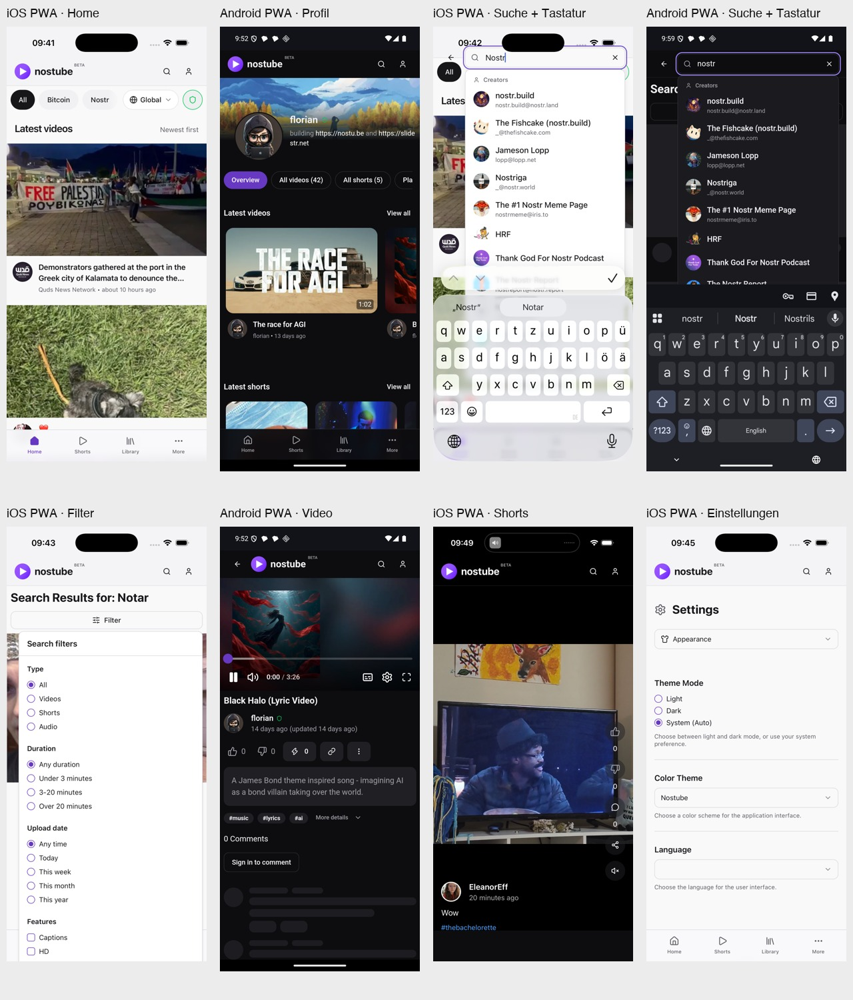

# Nostube: Mobile UI-Review

Stand: 14.10.2026. Analyse des aktuellen Web-Clients; keine Änderungen am Anwendungscode.

## Entscheidung

**Kein Redesign.** Logo, violette Akzentfarbe, neutrale Flächen, große Vorschaubilder, horizontale Profil-Shelves und die bestehende mobile Navigation bleiben. Der größte Gewinn liegt in einer konsistenten mobilen Gestaltung und in der Behebung einiger tatsächlich abgeschnittener Bedienelemente.

Empfohlene Reihenfolge: **PWA-/Overlay-Probleme → einheitliche Abstände und Touch-Flächen → kompaktere Informationshierarchie → kleinere Detailkorrekturen.**

## Prüfung und Grenzen

| Umgebung | Tatsächlich geprüft |
| --- | --- |
| iPhone 17 Pro, iOS 26.5 Simulator | Safari; zusätzlich über „Add to Home Screen“ mit aktiviertem „Open as Web App“ installierte PWA. Native Screenshots mit 1206 × 2622 Pixeln. |
| Android 36, AVD `amber_test`, Chrome 133 | Chrome; zusätzlich über Chrome „Install“ installierte Home-Screen-PWA. Start über das App-Icon, ohne Adressleiste. `WebappActivity`, `display-mode: standalone = true`, aktive `/sw.js`; PWA-Viewport 412 × 842 CSS-Pixel. Native Screenshots mit 1080 × 2400 Pixeln. |
| Ergänzende Chromium-Prüfung | Mobile Viewport-Emulation für Share- und Login-Methoden-Dialog sowie DOM-Messungen. Diese Bilder sind ausdrücklich **keine Emulator-Screenshots**. |

Browser-Prüfung über den lokalen Vite-Server auf Port 5173. PWA-Prüfung mit einem echten Produktions-Build auf `http://localhost:4173/`; Android erreicht diesen sicheren Localhost-Kontext über `adb reverse`. Die PWA wurde nicht durch CSS-Media-Emulation simuliert.

Geöffnet und bedient: Home/Kategorien, Suche und Filter, Videoseite, Creator-Profil, Shorts-Übersicht und Short-Player, Bibliothek als Gast, leerer Verlauf, Einstellungen, Gast-Einstieg zum Upload und Login-Dialog. In beiden installierten PWAs zusätzlich Suche mit **voller Bildschirmtastatur**, Navigation und Video-/Short-Oberflächen. iOS zusätzlich Hell-/Dunkelwechsel, App verlassen/zurückkehren sowie Querformat und Rückkehr ins Hochformat.

**Nicht verifiziert:** abgeschlossene Anmeldung, Signer-/Bunker-Handoff, angemeldete Bibliothek, tatsächliches Uploaden/Veröffentlichen, Zahlungen, Offline-Betrieb und Service-Worker-Update-Wechsel. Die Befunde zu diesen Bereichen beschränken sich auf die erreichbaren Gast-Oberflächen. Medien und Profile kommen von öffentlichen Relays; wechselnde Inhalte, Zähler und temporäre Ladezustände sind kein belegter Designfehler. Ein 320-Pixel-Screen blieb im Ladezustand und wird nicht als belastbarer Schmalbildschirm-Beleg verwendet.

Die vollständigen PNGs liegen neben diesem Bericht. `ios-*` und `android-*` sind native Emulator-Aufnahmen; `*-pwa-*` bezeichnet die installierte App; `chromium-*` bezeichnet ergänzende Desktop-Chromium-Emulation. Der Login-Pairing-QR wurde im erhaltenen Methoden-Screenshot geschwärzt. Fehlerhafte bzw. irreführende Aufnahmen wurden entfernt.

## 1. Zuerst beheben: echte Bedienungs- und PWA-Probleme

P0: ein zentraler Bedienbereich wird abgeschnitten. P1: Navigation, Lesbarkeit oder ein klar sichtbarer Zustand ist fehlerhaft. P2: gestalterische Verbesserung ohne belegte Funktionsblockade.

| ID | Priorität | Befund und Bildbeleg | Behutsame Änderung |
| --- | --- | --- | --- |
| 01 | P0 | **Suchfilter läuft aus dem Bildschirm.** Im Android-PWA-Viewport von 842 px beginnt das Panel bei ca. 149 px und endet bei ca. 1007 px; Höhe ca. 859 px. „Sort by“ liegt außerhalb des sichtbaren Bereichs. Auch iOS und Browser betroffen. [Android PWA](android-pwa-search-filter.png), [iOS PWA](ios-pwa-search-filter.png), [Android Browser](android-search-filter.png). | Mobil ein höhenbegrenztes, innen scrollbares Bottom Sheet mit sichtbarem Schließen und Zurücksetzen. Desktop-Popover behalten. Keine Änderung an den Filteroptionen oder ihrer Logik. |
| 02 | P0 | **iOS-PWA: aufgeklappte Suche liegt unter der Dynamic Island** und überlappt die Kategorien. Der normale Header sitzt korrekt darunter. [Ohne Tastatur](ios-pwa-search-expanded.png), [mit Tastatur](ios-pwa-search-keyboard.png). | Such-Header wie den normalen Header aufbauen: Safe-Area oben **zusätzlich** zur 56-px-Inhaltszeile, nicht innerhalb derselben festen Höhe. |
| 03 | P1 | **Suchvorschläge reichen hinter die Tastatur.** Auf beiden PWAs verschwindet der untere Teil der Creator-Liste einschließlich des Eintrags zur Videosuche. [iOS](ios-pwa-search-keyboard.png), [Android mit voller Tastatur](android-pwa-search-full-keyboard.png). | Vorschlagsliste auf den tatsächlich verfügbaren Bereich begrenzen und innen scrollen. „Videos suchen“ sichtbar halten; Sucheingabe mit passendem `enterKeyHint` und ohne störende Autokorrektur. |
| 04 | P1 | **iOS-PWA-Shorts enden vor dem unteren Bildschirmrand.** Unter der schwarzen Playerfläche bleibt ein breiter Streifen der Seitenfarbe: hell im hellen Theme, dunkel im dunklen. Weiterhin sichtbar nach App-Rückkehr und nach Querformat → Hochformat. [Hell](ios-pwa-short-player.png), [Dunkel](ios-pwa-short-dark.png), [nach Rückkehr](ios-pwa-short-resumed.png), [nach Rotation](ios-pwa-short-portrait-return.png). | Vorhandene Vollbild-Höhenmessung und Container-Begrenzungen auf dem echten Standalone-WebKit prüfen. Schwarze Medienfläche bis zum Rand; **Bedienelemente** oberhalb der unteren Safe Area. Nicht einfach den Streifen übermalen. Die genaue Ursache ist hier nicht diagnostiziert. |
| 05 | P1 | **Shorts im iOS-PWA-Querformat: Aktionsleiste wird abgeschnitten** und reicht in Header/Systembereiche. Gleichzeitig erscheint die breite Desktop-Suche. [Querformat](ios-pwa-short-landscape.png). | Für geringe Bildschirmhöhe eine kompakte Aktionsanordnung vorsehen; obere sowie linke/rechte Safe Areas beachten. Ein breites Telefon im Querformat braucht nicht automatisch die volle Desktop-Header-Belegung. |
| 06 | P1 | **Shorts haben keinen sichtbaren Zurück-Pfeil**, obwohl die untere Navigation ausgeblendet ist. Die normale Videoseite besitzt ihn. In der PWA fehlt zusätzlich die Browser-Zurück-Navigation. [Short](ios-pwa-short-dark.png), [normales Video](ios-pwa-video.png). | Bestehende Zurück-Navigation auch bei `/short/…` anzeigen. Kein neues Navigationsmodell. |
| 07 | P1 | **Short-Controls übernehmen das Seiten-Theme statt eine Medien-Overlay-Farbe.** Im hellen Theme werden Header-Icons und Zähler auf schwarzen Flächen fast unsichtbar; im dunklen Theme ist der Kontrast deutlich besser. [Hell](ios-pwa-short-player.png), [Dunkel](ios-pwa-short-dark.png). | Auf Video immer helle Symbole/Zähler, dunkle transparente Buttonfläche und dezenter Scrim. Lesbarkeit nicht von Hell/Dunkel oder vom gerade gezeigten Frame abhängig machen. |
| 08 | P1 | **Sprachauswahl zeigt keinen aktuellen Wert.** Sichtbar unter iOS und Android, auch in beiden PWAs. [iOS PWA](ios-pwa-settings.png), [Android PWA](android-pwa-settings.png). | Die effektiv angezeigte Sprache zuverlässig als Select-Wert darstellen. `[INFERENCE]`: `i18n.language` kann einen regionalen Code liefern, während die Optionen nur `en`, `de`, … enthalten. Vor der Korrektur den tatsächlichen Wert prüfen; die Screenshots belegen den leeren Zustand, nicht diese Ursache. |
| 09 | P1 | **Untere Navigation braucht eine echte PWA-Safe-Area-Regel.** iOS-Labels liegen sehr nah am unteren Rand; die Navigation bleibt im Code fest 64 px hoch. `pb-safe-area-inset-bottom` hat in den untersuchten Styles keine Definition. [iOS PWA Home](ios-pwa-home.png), [Bibliothek](ios-pwa-library.png). | Inhaltszeile plus `env(safe-area-inset-bottom)` als zusätzliche Höhe/Padding; denselben Platz im Seiteninhalt reservieren. Labels nicht in die Gestenzone setzen. Kein pauschal höherer Balken im normalen Browser. |

### Technische Anknüpfungspunkte

- [Header.tsx](../../../apps/web/src/components/Header.tsx): Suchzustand hat `h-14` direkt auf dem Header mit zusätzlichem `paddingTop`; normaler Header hat die 56-px-Zeile **innerhalb** des gepolsterten Headers. Außerdem erkennt `isVideoPage` hier `/short/…` nicht, anders als das MainLayout.
- [GlobalSearchBar.tsx](../../../apps/web/src/components/GlobalSearchBar.tsx): absolute Vorschlagsliste mit `overflow-hidden`, ohne begrenzte Höhe/inneres Scrollen; Sucheingabe ohne spezielle mobile Tastaturhinweise.
- [SearchFiltersButton.tsx](../../../apps/web/src/components/SearchFiltersButton.tsx): desktopartiges Popover, keine maximale Höhe und kein eigener vertikaler Scrollbereich.
- [MobileBottomNav.tsx](../../../apps/web/src/components/MobileBottomNav.tsx), [MainLayout.tsx](../../../apps/web/src/components/MainLayout.tsx), [index.css](../../../apps/web/src/index.css): feste 64-px-Navigation und reservierter Platz müssen zusammen mit den Safe Areas betrachtet werden.
- [ShortsVideoPage.tsx](../../../apps/web/src/pages/shorts/ShortsVideoPage.tsx), [ShortVideoOverlay.tsx](../../../apps/web/src/pages/shorts/ShortVideoOverlay.tsx), [app-height.ts](../../../apps/web/src/lib/app-height.ts): vorhandene Vollbild- und Rückkehr-Behandlung weiterverwenden; keinen zweiten Viewport-Mechanismus einführen.
- [AppearanceSection.tsx](../../../apps/web/src/components/settings/AppearanceSection.tsx): Sprach-Select bekommt direkt `i18n.language`; Optionen enthalten ausschließlich Basiscodes.

## 2. Kleine Änderungen mit großer gestalterischer Wirkung

Diese Vorschläge sind keine Behauptungen über kaputte Funktionen. Sie reduzieren die sichtbaren Unterschiede zwischen den Seiten.

| ID | Bereich | Beobachtung | Konkreter Vorschlag |
| --- | --- | --- | --- |
| 10 | Seitenränder | Header/Einstellungen 16 px, Video-Info 8 px, Kartenmetadaten 12 px, Gast-Bibliothek ohne mobilen Außenabstand. | **16 px Standard-Inset** für Text, Überschriften und Formulare. Nur Player, Feed-Thumbnails und bewusst immersive Medien randlos. |
| 11 | Abstände | Ähnliche Abschnitte haben unterschiedliche vertikale Luft; besonders groß zwischen Settings-Navigation und „Theme Mode“. | Bestehende Abstände auf wenige Rollen reduzieren: 8 px innerhalb enger Gruppen, 12–16 px zwischen Elementen, 24 px zwischen Abschnitten. In Settings nicht `mb-6` und den zusätzlichen großen Parent-Gap stapeln. |
| 12 | Typografie | Seitenüberschriften, Shelf-Titel, Filtertitel und Metadaten wirken nicht wie eine gemeinsame Hierarchie. | Mobile Seitentitel 22–24 px, Abschnittstitel 18–20 px, Kartentitel etwa 15–16 px, Sekundärtext 12–14 px. Bestehende Schrift behalten; Gewicht und Zeilenhöhe vereinheitlichen. |
| 13 | Touch-Flächen | Header-Buttons ca. 40 × 40 px; Radio- und Checkbox-Reihen sind sehr dicht. | 44–48 px bedienbare Fläche, ohne jedes sichtbare Icon aufzublasen. Ganze Optionszeile klickbar und mit deutlichem Fokus-/Auswahlzustand. |
| 14 | Bottom Nav | 10-px-Labels sind sehr klein; aktive Icons werden gefüllt, übrige bleiben Outline. | Labels auf 11–12 px, identische Icon-Geometrie und einen konsistenten aktiven Zustand. Vier Positionen und violette Hervorhebung behalten. |
| 15 | Home-Filter | „Global“ und Trust-Schalter beanspruchen viel Breite; Kategorien werden früh verdrängt. [Home](ios-pwa-home.png). | Kategorien als primäre Entdeckung behandeln. Quelle und Sicherheit kompakter gruppieren bzw. im vorhandenen mobilen Filterbereich erklären; **aktive Sicherheitsfilter weiter sichtbar halten**, nichts heimlich entfernen. |
| 16 | Kartenmetadaten | Titel, Avatar und Zeit bilden große Blöcke; lange Namen konkurrieren mit dem Titel. [Home](ios-pwa-home.png). | Eine feste zweizeilige Titelrolle und eine ruhige Metadatenzeile. Creator-Name bei Platzmangel sauber kürzen; Avatar/Metadaten-Abstände auf allen Listen gleich halten. |
| 17 | Suche | Nach der Suche verschwindet das Eingabefeld. Ein großer „Search Results for…“-Titel und ein eigener vollbreiter Filterknopf dominieren. Beim erneuten Öffnen der Suche war das Feld trotz vorhandener Ergebnis-Query leer. [Suche](ios-search.png), [PWA-Filter](android-pwa-search-filter.png). | Query dauerhaft editierbar bzw. beim Wiederöffnen vorausgefüllt; kompakte Ergebniszeile und Filter daneben. Lange Queries dürfen nicht die gesamte erste Bildschirmhälfte verdrängen. |
| 18 | Profilkopf | 96-px-Avatar lässt die Bio in einer schmalen rechten Spalte; URLs brechen unglücklich um. [iOS Profil](ios-profile.png), [Android PWA](android-pwa-profile.png). | Avatar, Name und Aktionen in einer Kopfzeile; Bio danach über die volle Inhaltsbreite. Banner behalten. Lange Links mit sinnvoller sichtbarer Bezeichnung und kontrolliertem Umbruch. |
| 19 | Profil-Tabs | Breite Pills mit „All videos (42)“, „All shorts (5)“ usw. zeigen nur einen Teil der Bereiche. | Kürzere Labels „Videos“, „Shorts“; Counts optisch sekundär. Gemeinsame kompakte Tab-Geometrie und erkennbarer horizontaler Scrollhinweis. Alle bisherigen Bereiche behalten. |
| 20 | Profil-Shelves | Pinned-/Latest-Shelves haben unterschiedliche Kartenbreiten; jede Karte wiederholt den schon bekannten Profil-Autor. | Gemeinsames mobiles Breiten-/Gap-Muster mit sichtbarem Peek der nächsten Karte. Auf dem eigenen Profil vorhandenes `hideAuthor` nutzen, statt Avatar und Namen ständig zu wiederholen. |
| 21 | Shorts-Grid | Zweispaltige Tiles stoßen nahezu direkt aneinander und zeigen kaum Orientierung über den Inhalt. [Shorts](ios-shorts.png). | Zwei Spalten behalten; kleiner 2–4-px-Gap. Ein bis zwei kurze Titel-/Creator-Zeilen als zurückhaltendes Overlay mit Verlauf, nicht als vollwertige große Feed-Karte. |
| 22 | Videoseite | Likes/Dislikes sind frei stehende Icons, Zap/Share/Mehr große Boxen; ungleiche visuelle Gewichte. [Android PWA Video](android-pwa-video.png). | Gemeinsame Höhe, Touch-Fläche und Abstände für die Aktionszeile. Zap darf Akzent sein; restliche Aktionen ruhiger. Keine zusätzliche zweite Toolbar. |
| 23 | Share-Aktion | Normales Video nutzt ein Link-Symbol; Shorts nutzen „Share“, kopieren im Code aber nur den Link. | Sichtbare Handlung und Icon zusammenbringen: „Link kopieren“ mit Rückmeldung, oder ein echtes Teilen-Angebot. Auf beiden Playern dieselbe Bedeutung. |
| 24 | Videometadaten | „14 days ago (updated 14 days ago)“ ist sichtbare Doppelinformation. | Update-Hinweis nur zeigen, wenn er in der dargestellten Granularität tatsächlich etwas ergänzt; exakten Zeitpunkt in Details weiterhin erreichbar lassen. |
| 25 | Beschreibung/Tags | Beschreibung, Tags und „More details“ besitzen unterschiedliche Gewichte und Abstände. | Beschreibung als kompakter 2–3-Zeilen-Block mit klarer Erweiterung; Tags und Details als einheitliche sekundäre Zeile. Bestehende Informationen nicht löschen. |
| 26 | Kommentare | „0 Comments“, „Sign in to comment“ und weit darunter „Start the conversation“ verteilen einen einzigen Leerzustand über viel Fläche. [iOS PWA Video](ios-pwa-video.png). | Eine gemeinsame kleine Empty-State-Gruppe: kurzer Hinweis plus eindeutiger Login-CTA. Überschrift/Abstände an andere Abschnitte angleichen. |
| 27 | Gast-Bibliothek | Die gerundete Login-Karte klebt am Header und an beiden Bildschirmrändern; darunter viel leere Fläche. [iOS PWA](ios-pwa-library.png), [Android PWA](android-pwa-library.png). | 16-px-Außenrand und 24-px-Abstand zum Header. Kompakter Nutzenhinweis, ein primärer Login-CTA, optional vorhandener Weg zum Stöbern als sekundärer Link. |
| 28 | Verlauf/Upload-Gastseite | Ähnliche „hier ist noch nichts/bitte anmelden“-Zustände haben andere Zentrierung, Buttonform und Abstände. [Verlauf](ios-history.png), [Upload-Einstieg](ios-upload.png). | Gleiche Empty-State-Anatomie und Button-Rolle. Im Upload-Einstieg die drei bestehenden Schritte beibehalten; keine neue Illustration oder zusätzliche Erklärungsebene nötig. |
| 29 | More-Sheet | Im geprüften Gastzustand enthält „More“ nur „Settings“; großes Titel-/Leerflächengewicht für eine Zeile. [iOS PWA](ios-pwa-more.png). | Einzeiligen Gastzustand kompakter gestalten. Titel, Inset und Close-Touch-Fläche an andere mobile Sheets angleichen. Keine neuen Menüeinträge nur zum Auffüllen erfinden. |
| 30 | Share-Dialog | Ein desktopartiger, randbreiter Mitteldialog; Social-Ziele nur als Icons. Das generische Share-Icon steht hier sogar für Pinterest. [Chromium-Ergänzung](chromium-share.png). | Mobil ein kurzes Sheet oder klar insetter Dialog: primär Teilen/Kopieren, beschriftete Ziele, Embed sekundär. Falls native Web Share ergänzt wird, vorhandenen Link-/Embed-Dialog als bewusste Alternative behalten. |
| 31 | Login | Welcome-Dialog funktioniert, berührt aber seitlich die Bildschirmkante. Methoden-Dialog kombiniert auf kurzer Höhe Signer-CTA und sehr großen QR. [native iOS PWA](ios-pwa-login.png), [Chromium-Methoden, QR geschwärzt](chromium-login-methods-redacted.png). | Konsistente mobile Dialog-/Sheet-Geometrie. „Auf diesem Gerät“ und „Anderes Gerät“ klar trennen; QR erst bei Bedarf zeigen. **Alle Login-Methoden und Sicherheitsmaßnahmen erhalten.** |
| 32 | App-Icon/PWA-Flächen | Manifest besitzt PNG/SVG-Icons ohne explizites `maskable`-Purpose. Normaler Seitenhintergrund und Medien-Hintergrund haben unterschiedliche Aufgaben. | Vor Release ein sicher beschnittenes maskierbares Icon vorsehen und Status-/Gestenflächen in beiden Themes prüfen. Bestehendes Logo behalten. Dies ist eine Manifest-/Release-Empfehlung, kein nachgewiesener Icon-Defekt. |

## 3. Kleine gemeinsame Gestaltungsvorgaben

- **Farben:** bestehende OKLCH-/Theme-Tokens verwenden; Violett bleibt Akzent, nicht Flächenfarbe jeder Steuerung. Medien-Overlays besitzen unabhängig davon ihren eigenen hohen Kontrast.
- **Geometrie:** bestehende 12-px-Grundrundung für Controls/Karten; randlose Medien nur dort, wo bewusst gewollt. Mobile Sheets mit gemeinsamer Oberkante und Insets. Nicht alle Thumbnails nachträglich in gerundete Container packen.
- **Hierarchie:** Inhalt zuerst, Metadaten danach, technische Details auf Nachfrage. Sekundärtext muss auch im hellen Theme lesbar bleiben.
- **Navigation:** existierende Tabs/Routes und vertraute Positionen behalten. Zurück-Pfeil auf allen immersiven Detailseiten; keine fünfte Navigationsposition und kein neues Menüsystem.
- **Komponenten:** vorhandene Shared Widgets, Sheet/Dialog, RadioGroup, Select und Theme-Tokens weiterverwenden. Zunächst lokale Klassen und die schon gemeinsam verwendeten Komponenten angleichen; keine neue Design-System-Schicht und keine zusätzliche UI-Bibliothek.

## 4. Empfohlene Umsetzungspakete und Abnahme

### A — Mobile Bedienbarkeit/PWA

IDs 01–09. Erst Grenzen und Navigation korrigieren, dann die Kontrastregeln für Medien.

Abnahme auf **installierter** iOS- und Android-PWA: Suche mit voller Tastatur; letzte Suchvorschläge/Videosuche erreichbar; jede Filtergruppe einschließlich Sortierung scrollbar; Close/Reset sichtbar; Shorts mit sichtbarem Zurück-Weg; Header unter der Notch; Labels oberhalb der Gestenzone; schwarze Short-Fläche bis zum Rand. iOS außerdem App-Rückkehr und beide Rotationsrichtungen. Language-Select zeigt die aktuelle Sprache auch beim initialen Start.

### B — Konsistenz auf den häufigen Seiten

IDs 10–26. Gemeinsame Seitenränder, Typografie, Touch-Flächen und Metadatenrollen; dann Profilkopf/Tabs und Videoseite.

Abnahme: Home, Suche, Profil und Video besitzen dieselben Text-Inset-Linien. Lange Titel/Creator-Namen bleiben lesbar und verdecken keine Aktionen. Profil-Bio erhält mobile Breite; Shelves zeigen weiterhin den nächsten Eintrag. Hell und Dunkel prüfen, ohne öffentliches Relay-Ladeverhalten mit Layoutproblemen zu verwechseln.

### C — Gastzustände und Dialoge

IDs 27–32. Library/Verlauf/Upload-Einstieg und More-/Share-/Login-Oberflächen angleichen.

Abnahme: Gast-CTAs und Dialoge folgen derselben Geometrie. Login-/Share-Optionen bleiben vollständig erreichbar; Pairing-/Secret-Daten werden nicht in Review-Artefakten veröffentlicht. Angemeldete Upload-/Bibliotheksabläufe benötigen danach einen separaten, autorisierten Durchlauf — sie sind durch diesen Gast-Review nicht abgedeckt.

## Bildindex

| Oberfläche | iOS | Android |
| --- | --- | --- |
| Home im Browser | [Safari](ios-home.png) | [Chrome](android-home.png) |
| Home installiert | [PWA](ios-pwa-home.png) | [PWA](android-pwa-home.png) |
| Suche im Browser | [Safari](ios-search.png) | [Chrome](android-search.png) |
| Suche mit voller Tastatur | [PWA](ios-pwa-search-keyboard.png) | [PWA](android-pwa-search-full-keyboard.png) |
| Suchfilter installiert | [PWA](ios-pwa-search-filter.png) | [PWA](android-pwa-search-filter.png) |
| Normales Video | [Safari](ios-video.png), [PWA](ios-pwa-video.png) | [Chrome](android-video.png), [PWA](android-pwa-video.png) |
| Profil | [Safari](ios-profile.png) | [PWA](android-pwa-profile.png) |
| Shorts-Übersicht | [Safari](ios-shorts.png) | [Chrome](android-shorts.png) |
| Short-Player | [Safari](ios-short-player.png), [PWA hell](ios-pwa-short-player.png), [PWA dunkel](ios-pwa-short-dark.png) | [Chrome](android-short-player.png), [PWA](android-pwa-short-player.png) |
| Bibliothek als Gast | [PWA](ios-pwa-library.png) | [PWA](android-pwa-library.png) |
| Einstellungen | [PWA](ios-pwa-settings.png) | [PWA](android-pwa-settings.png) |
| Weitere Zustände | [Verlauf](ios-history.png), [Upload-Gastseite](ios-upload.png), [PWA More](ios-pwa-more.png), [PWA Login](ios-pwa-login.png) | [Verlauf](android-history.png), [More](android-more.png) |

Ergänzende Chromium-Aufnahmen: [Share](chromium-share.png), [Welcome](chromium-login.png), [Login-Methoden mit geschwärztem QR](chromium-login-methods-redacted.png). Keine Behauptung über abgeschlossene Authentifizierung oder den tatsächlichen externen Share-/Signer-Handoff.
